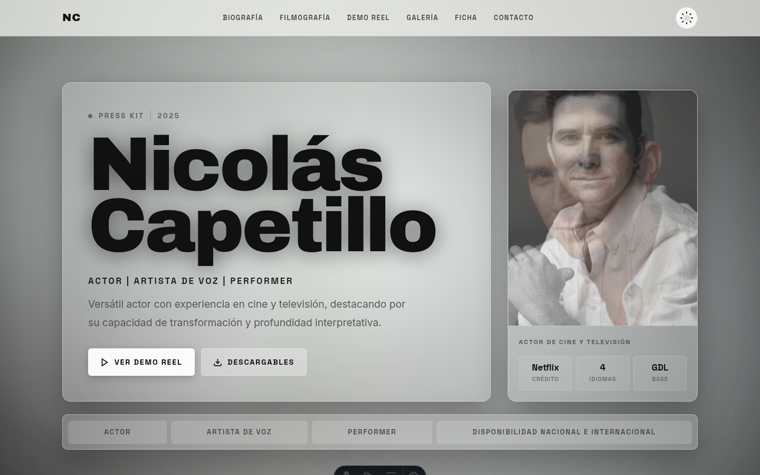
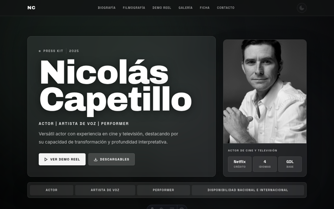
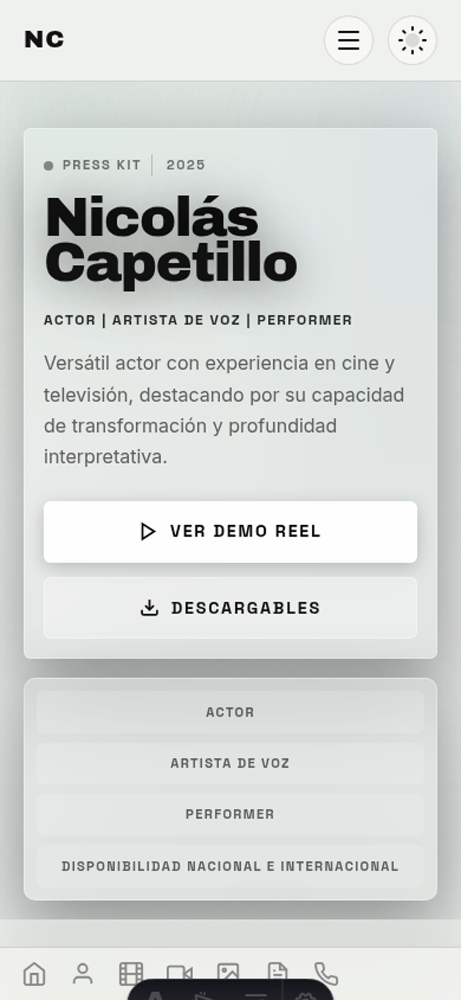
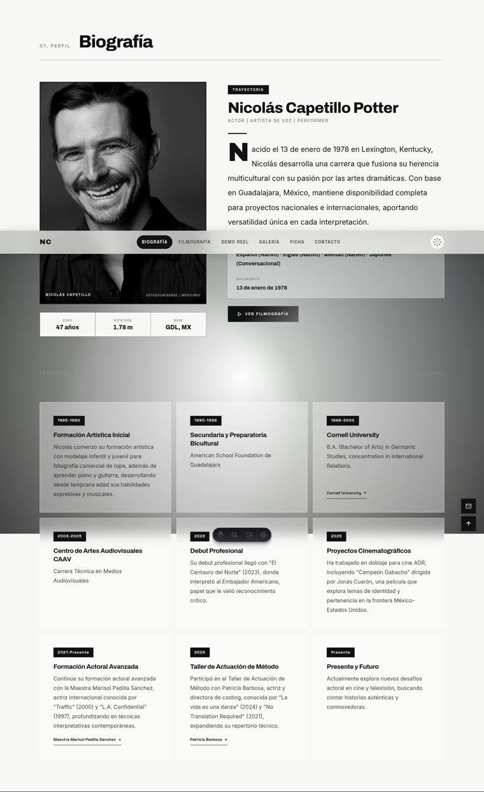
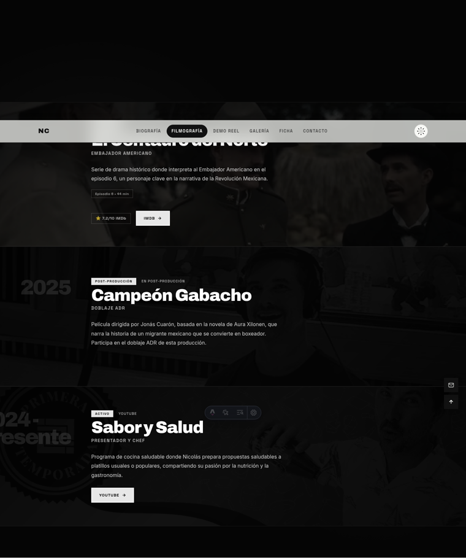
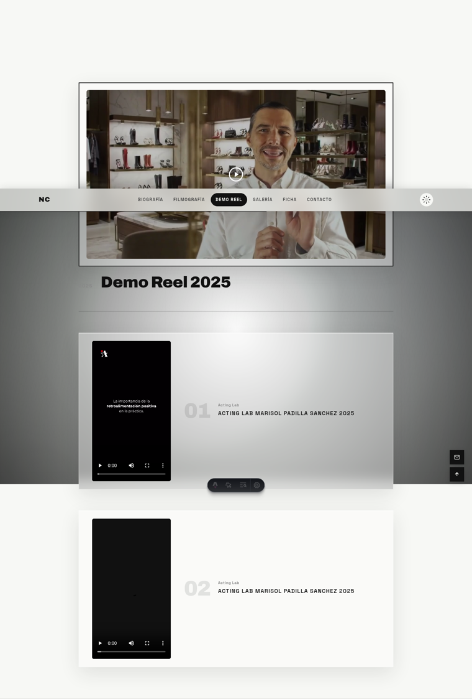
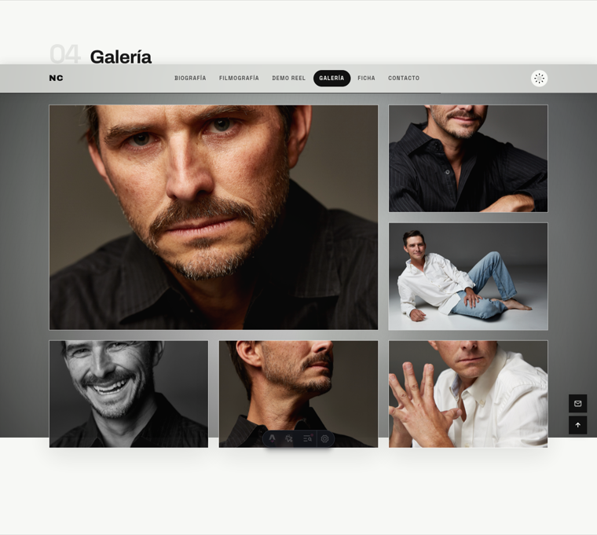
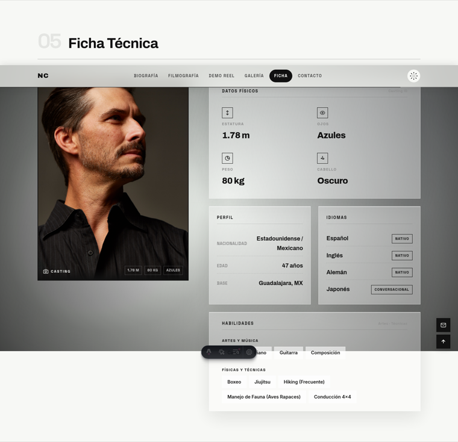
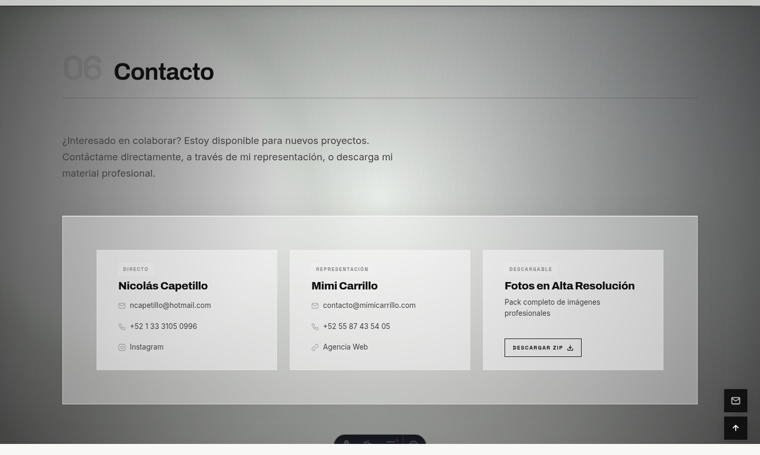
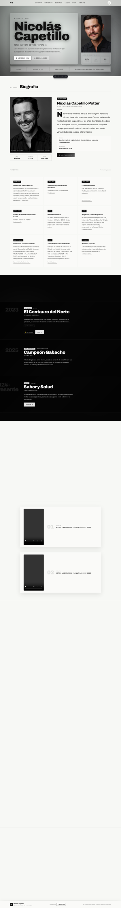

# AUDITORÍA VISUAL Y TÉCNICA — PRESS KIT NICOLÁS CAPETILLO

```
DOC-REF:      AUDIT/PRESS-KIT-2026-10-15
SIG:          Auditoría integral de sitio + propuesta de dirección visual
DIVISION:     MVGN Labs — Research & Creative Systems Division
NODE:         MX-03
FECHA:        2026-10-15
ALCANCE:      nicolas-astro/ (Astro 6.4.2) — sitio en producción nicolascapetillo.vercel.app
REVISIÓN:     commit 187a68e · repo v1.1.0
MÉTODO:       inspección de código + render headless (Chromium 156) + medición de red real
AUDITOR:      OpenCode (MVGN) bajo protocolo NYX v5.3 — modo SOLO
RESTRICCIÓN:  El contenido NO se modifica. Esta auditoría propone solo CÓMO mostrarlo.
```

---

## 0. Resumen ejecutivo

**Veredicto global: la identidad visual está por encima del promedio; la ejecución de entrega está por debajo del mínimo profesional.**

| Dimensión | Nota | Comentario |
|:---|:---:|:---|
| Identidad / dirección de arte | **7.5 / 10** | El nombre gigante en Archivo + fotografía B&N + tiras oscuras de filmografía funcionan. Es reconocible. |
| Jerarquía y ritmo | **5 / 10** | Densidad desigual: Contacto esponjoso, Biografía con huecos muertos, Demo Reel desperdicia 80 % del área. |
| Legibilidad / contraste | **6 / 10** | Textos fantasma (opacidad 0.08–0.6) y microetiquetas mono por todos lados. |
| Rendimiento | **2 / 10** | **81 MB antes de hacer scroll en móvil.** 28.7 MB de carga inicial en desktop. LCP 4.7 s en localhost. |
| Accesibilidad | **5 / 10** | Filmografía navegable por teclado; galería NO. Lightbox sin gestión de foco. |
| Metadata / compartibilidad | **2 / 10** | Sin Open Graph, sin schema, sin sitemap/robots. Este sitio se comparte por WhatsApp y correo. |

### Los 3 bloqueadores (P0)

1. **Peso.** Una foto del sitio pesa más que el sitio entero debería pesar. Assets: 115 MB en 37 JPEG de **3840×5760 a 300 dpi**. El carrusel del hero descarga **9 fotos ≈ 27 MB** y muestra una. En móvil, 81 MB antes del primer scroll. Un director de casting en datos móviles cierra la pestaña.
2. **9 de las 34 fotos de la galería dan 404.** El JSON las referencia en `/assets/fotos/` pero viven en `/assets/fotos hero section/`. Verificado: HTTP 404 en las 9. La galería y el lightbox están rotos al 26 %.
3. **El enlace compartido no tiene tarjeta.** Sin `og:*` ni `twitter:*`: al mandar la URL por WhatsApp o correo aparece un enlace pelón, sin foto. La primera impresión del press kit es la que NO se ve.

### Lo que NO hay que tocar

- El lockup tipográfico del héroe (**Archivo 900**, `Nicolás / Capetillo` en dos líneas) — es la firma del sitio.
- La fotografía en B&N como sistema — es coherente y cara de "press kit de cine".
- La sección **Filmografía** — el mejor momento del sitio: tiras oscuras, año, rol, plataforma, rating. No rehacer, solo afinar.
- La estructura de **Ficha Técnica** — es la sección más útil para el usuario real (casting) y la más disciplinada del sitio.

---

## 1. Método y alcance

1. Lectura completa de `src/` (9 componentes, layout, design system, datos).
2. Render headless con Chromium 156 (Playwright) en 3 configuraciones:
   - Desktop 1440×900 (claro y oscuro)
   - Móvil 390×844 @2x (claro)
3. Medición de red instrumentada: `content-length` por respuesta, recursos, duplicados, LCP/CLS, peso antes y después de scroll completo.
4. Verificación de existencia real de cada asset referenciado por el JSON (HTTP contra el dev server).
5. Capturas por sección como evidencia (`evidencia/`, anexo A).

**Advertencia metodológica:** las mediciones se hicieron contra `astro dev` en localhost, sin latencia, con caché frío. En producción (Vercel) el HTML/CSS/JS irá comprimido y con CDN — pero **las fotos se sirven exactamente igual de pesadas**, así que el hallazgo de peso aplica 1:1. El LCP real en 4G será **peor** que el medido.

---

## 2. Evidencia dura (mediciones)

| Métrica | Desktop 1440×900 | Móvil 390×844 |
|:---|---:|---:|
| Peso **antes** de scroll | **28.74 MB** / 75 reqs | **81.64 MB** / 67 reqs |
| Peso **después** de scroll completo | **111.95 MB** / 75 reqs | (no medido hasta el final) |
| URLs únicas | 58 (→ 17 recursos se descargan 2–3 veces) | — |
| LCP | 4.74 s (localhost) | — |
| CLS | 0 (bien resuelto con `aspect-ratio`) | — |
| JS transferido | 0.93 MB | — |
| JPEG | 96.95 MB de 111.95 MB (**87 % del peso**) | — |

### Inventario de imágenes

- **37 JPEG**, cada uno **3840×5760 px, 300 dpi**, cámara Canon EOS 5D Mark III (metadatos `.jpg` crudos de Capture One).
- Los 5 más pesados: `5.jpg` 4.01 MB · `_P5A7082.jpg` 3.6 MB · `3.jpg` 3.56 MB · `newfront.jpg` 3.49 MB · `1.jpg` 3.44 MB.
- **Ningún** `<picture>`, `srcset`, `sizes`, WebP ni AVIF. Ningún width/height explícito en imágenes de filmografía.
- Carpeta `fotos hero section/`: 9 fotos ≈ 24–27 MB, todas descargadas al cargar (el JS asigna `src` a las 9 apenas inicia — `Hero.astro:641-643`).
- **EXIF con GPS presente** en los archivos publicados (privacidad: la ubicación de las sesiones de fotos viaja en el archivo).
- Videos: `video1.mp4` 8.1 MB + `video2.mp4` 5.2 MB, sin poster, sin reencode. `preload="metadata"` ✓.

### Recursos duplicados (bug de doble fetch)

`4.jpg` ×3 · `5.jpg` ×3 · las 9 fotos del hero ×2 · `1.jpg` ×2 · `2.jpg` ×2 · `3.jpg` ×2 · `6.jpg` ×2 → **17 recursos repetidos**. Causa: los mismos archivos se referencian desde componentes distintos (bio + galería + ficha) y el navegador no los cachea within-page por las rutas/atributos distintos.

### Metadata de distribución

| Elemento | Estado |
|:---|:---|
| `og:title`, `og:image`, `og:description` | **Ausentes** (`Layout.astro:15-38` solo tiene `<title>` y `description`) |
| `twitter:card` | Ausente |
| JSON-LD `Person` (sameAs IMDb/Instagram, jobTitle) | Ausente |
| `robots.txt` / `sitemap.xml` | Ausentes (`public/` solo tiene favicon + assets) |
| `theme-color` | Ausente |
| Favicon SVG + ICO | ✓ presentes |
| `lang="es"` | ✓ correcto |

---

## 3. Hallazgos por severidad

### Bloqueantes (P0)

**H-01 · Peso de página catastrófico — 81 MB móvil antes de scroll**
- *Evidencia:* medición de red (§2); `Hero.astro:58-66` + `:641-643`; assets 3840×5760.
- *Impacto:* abandono en móvil/roaming; el sitio no cumple su función (ser visto).
- *Recomendación:* pipeline `astro:assets` (sharp ya está en el árbol) con tiers 480/768/1200/1920, AVIF+WebP, `strip` de metadatos, calidad 55–70. Objetivo: **≤ 250 KB por foto a 1600 px**; hero ≤ 400 KB total.

**H-02 · 9 fotos de la galería rotas (404)**
- *Evidencia:* HTTP 404 verificado en `_P5A7048, 7051, 7080, 7081, 7107, 7121, 7122, 7145, 7147` referenciadas en `src/data/nicolas.json` → `gallery[]` como `/assets/fotos/…`, pero los archivos están en `public/assets/fotos hero section/`.
- *Impacto:* 26 % de la galería y del lightbox roto. Un casting director lo lee como "sitio abandonado".
- *Recomendación:* mover las 9 fotos a `/assets/fotos/` (o corregir rutas) y de paso duplicar el hallazgo: el hero ya usa esas mismas 9 → una sola ruta canónica resuelve también H-06.

**H-03 · Sin Open Graph: el enlace compartido no tiene imagen ni resumen**
- *Evidencia:* `Layout.astro` sin `og:*`.
- *Impacto:* el 90 % de las visitas de un press kit llegan por link (WhatsApp/correo). Sin tarjeta, se pierde la primera impresión.
- *Recomendación:* `og:image` 1200×630 generada del mismo contenido (retrato + nombre + "Actor de cine y televisión"), `og:title/description`, `twitter:card=summary_large_image`, `canonical`, `theme-color`.

### Altos (P1)

**H-04 · El hero móvil no muestra el rostro**
- *Evidencia:* `Hero.astro:515` — `.hero-card { display: none }` bajo 1024 px. Captura `02-hero-mobile.png`: la primera pantalla del móvil es texto sobre vidrio, sin cara.
- *Impacto:* en un press kit de actor, no ver al actor en la primera pantalla es el error más caro.
- *Recomendación:* bajo 1024 px, banda de retrato (4:5, `object-position: center 20%`) arriba o detrás del copy; una sola imagen optimizada.

**H-05 · Galería inaccesible por teclado; lightbox sin semántica de diálogo**
- *Evidencia:* `.gallery-card` es `<div>` con `addEventListener('click')`, sin `tabindex`/`role` (verificado: `{"tag":"DIV","tabindex":null,"role":null}`). `#lightbox` sin `role="dialog"`, `aria-modal`, ni gestión/retorno de foco (`Gallery.astro:503-521`).
- *Impacto:* usuarios de teclado/lectores no pueden abrir las 34 fotos.
- *Recomendación:* cards → `<button>`; lightbox → `role="dialog" aria-modal="true"`, foco al botón cerrar, trampa de foco, retorno al disparador, `aria-live` para el contador. (La filmografía ya lo hace bien: `role="button"` + `tabindex=0` + `Enter`/`Espacio` — usar ese patrón como referencia interna.)

**H-06 · Descargas duplicadas de la misma imagen (2–3×)**
- *Evidencia:* §2 duplicados.
- *Recomendación:* rutas canónicas únicas + `astro:assets` (dedupe por hash). Ganancia inmediata sin tocar diseño.

**H-07 · EXIF GPS publicado**
- *Evidencia:* los `.jpg` conservan metadatos de cámara y `GPS-Data`.
- *Recomendación:* `strip` en el pipeline de imágenes. Coste: cero. Riesgo evitado: exposición de ubicaciones privadas.

**H-08 · Lucide (CDN, ~300 KB) cargado sin uso**
- *Evidencia:* `Layout.astro:38` carga `lucide@0.263.1` y `:51-52` llama `lucide.createIcons()`; **no existe un solo `data-lucide` en el proyecto** — todos los iconos son SVG inline.
- *Recomendación:* eliminar el script y la llamada. Menos JS, menos dependencia de terceros.

### Medios (P2)

**H-09 · Redundancia de contenido en el hero (mismo texto dos veces)**
- *Evidencia:* `hero-subtitle` = "Actor | Artista de Voz | Performer" y la barra `hero-credits` repite "Actor / Artista de voz / Performer" + "Disponibilidad nacional e internacional" (`Hero.astro:41` y `:89-94`). Captura `01`.
- *Recomendación (sin tocar contenido):* unificar en una sola línea; liberar la barra para datos que ya existen en el JSON (Netflix/IMDb, 4 idiomas, GDL, disponibilidad). Además `GDL` es opaco para un casting internacional → "Guadalajara, MX".

**H-10 · Etiqueta "Trayectoria" duplicada en Biografía**
- *Evidencia:* `bio-badge` "Trayectoria" arriba del nombre (`Biography.astro:52`) y `bio-tl-head` "Trayectoria / Formación y carrera" antes de la línea de tiempo (`:82-84`).
- *Recomendación:* conservar una. La línea de tiempo es **una secuencia real** (1985 → presente): el tratamiento correcto es cronológico (línea vertical, años al margen), no 9 tarjetas idénticas en grid (`:427`).

**H-11 · Hueco muerto entre biografía y cronología (~450 px de vacío)**
- *Evidencia:* captura `03`; `Biography.astro:398` (`padding-top: var(--sp-3xl)` = 6 rem) + `:403` (`margin-bottom: var(--sp-2xl)` = 4 rem) + encabezado fantasma en `--text-muted` con `opacity: 0.6`.
- *Recomendación:* comprimir el hueco y convertir el encabezado en índice pegajoso (sticky) de la cronología. Menos scroll para llegar a lo que importa.

**H-12 · Filmografía: el año gigante colisiona y el fondo es invisible en móvil**
- *Evidencia:* captura `04` — en "Sabor y Salud" el año `2024 - Presente` (`nicolas.json`) se parte: "2024" gigante + "PRESENTE" encimado; el fondo de cada fila vive a `opacity: 0.1` (`Filmography.astro:170`) y solo se revela en hover → en táctil nunca aparece.
- *Recomendación:* año como etiqueta pequeña + chip de estado ("2024 – Presente" en una línea); fondo a 0.2–0.3 en táctil (`@media (hover: none)`) o miniatura lateral permanente.

**H-13 · Demo Reel: los videos verticales se muestran minúsculos dentro de tarjetas enormes**
- *Evidencia:* captura `05`; `DemoReel.astro:35-51`. Los 9:16 ocupan ~150 px de ancho en un panel de 1300 px. Además los **dos clips comparten caption idéntico**: "ACTING LAB MARISOL PADILLA SANCHEZ 2025" (`nicolas.json → demoReel.verticalVideos`).
- *Recomendación:* marco con `aspect-ratio: 9/16` y ancho acotado (p. ej. 2 columnas de 320 px máx con aire), o un clip grande + uno secundario. Diferenciar captions (p. ej. "#01 / #02 Escena X") es decisión de contenido — **requiere al operador**.

**H-14 · Contacto sobredimensionado y sin el canal más usado (WhatsApp)**
- *Evidencia:* captura `08`; `Downloads.astro:241-245` (grid 3×). Sección de 862 px para 3 tarjetas con mucho aire. El JSON ya tiene WhatsApp (`contact.social[1]`) y no se muestra; solo Instagram.
- *Recomendación:* panel más denso (2 columnas: contactos a la izquierda, acciones a la derecha), añadir WhatsApp (dato existente), y convertir el ZIP a descarga alojada en el sitio (H-16).

**H-15 · Contraste por debajo de AA en textos informativos**
- *Evidencia:* números de sección `opacity: 0.08` (`global.css:300`), "TRAYECTORIA" a `0.6` sobre `--text-muted`, `bio-portrait-title`, contador del lightbox, etiquetas `0.6–0.7`. En capturas `03`, `05`, `08` hay texto gris casi ilegible sobre vidrio claro.
- *Recomendación:* los números de sección decorativos pueden quedarse bajos **pero `aria-hidden`**; cualquier texto con información sube a ≥ 4.5:1. Regla: si un dato no se lee, o sube el contraste o no es dato.

**H-16 · El ZIP de fotos apunta a OneDrive (link externo, no controlado)**
- *Evidencia:* `nicolas.json → downloads.photos.url` = `https://1drv.ms/u/c/...`.
- *Recomendación:* alojar el pack en el propio sitio (URL estable + nombre de archivo versionado) y generar también **ficha PDF** desde los mismos datos. Es el "entregable" que un casting realmente usa.

---

## 4. Lectura sección por sección

> Formato: qué funciona (conservar) · qué se corrige · veredicto.

### 4.1 Hero — *Funciona la firma, falla el envoltorio*




- **Conservar:** tipografía Archivo 900 a dos líneas, kicker "PRESS KIT · 2025", botones primario/secundario, tarjeta lateral con métricas.
- **Corregir:** (a) retrato ausente en móvil (H-04); (b) texto duplicado subtitle/credits (H-09); (c) **cuatro capas de superficie compitiendo**: canvas animado + 3 orbes borrosos + vidrio del copy + vidrio de la tarjeta + vidrio de la barra + gradiente de fondo (`global.css:52-63`, `Hero.astro:117-179`). El vidrio sobre vidrio sobre ruido produce la niebla gris de la captura 01.
- **Móvil:** la barra de credenciales se apila en 4 bloques (480 px de alto) — es el doble de espacio que el mensaje.
- **Veredicto: 7/10** (escritorio) · **4/10** (móvil).

### 4.2 Biografía — *Buen material, mal ritmo*


- **Conservar:** capitular "N", retrato + tarjeta de datos rápidos, doble párrafo de ficha.
- **Corregir:** hueco muerto (H-11), "Trayectoria" duplicada (H-10), cronología como 9 tarjetas uniformes cuando es una secuencia (H-10), y duplicación de datos rápidos (Edad/Estatura/Base) con la Ficha Técnica.
- **Veredicto: 6/10.**

### 4.3 Filmografía — *La mejor sección del sitio*


- **Conservar:** tiras oscuras, jerarquía título → rol → descripción → chips (plataforma, rating IMDb, duración), interacción completa por teclado, hover con color.
- **Corregir:** H-12 (año partido, fondo invisible en táctil). Añadir `loading` y tamaños declarados en la imagen de fondo; la animación `slowZoom` de 20 s sobre 3 imágenes de 3 MB es coste puro para un fondo al 10 %.
- **Veredicto: 8.5/10.**

### 4.4 Demo Reel — *Concepto claro, escala equivocada*


- **Conservar:** miniatura del reel de YouTube con botón play, crédito "2025", dos clips verticales numerados 01/02.
- **Corregir:** H-13 (escala + caption repetido). Además: la miniatura carga de `img.youtube.com` sin `poster` propio y el video vertical usa `preload="metadata"` sobre archivos sin recomprimir.
- **Veredicto: 6/10.**

### 4.5 Galería — *Buena idea, ejecución rota*


- **Conservar:** 6 destacadas + "Explorar las 34 fotos" → lightbox con contador, navegación, swipe y descarga; hover con overlay numerado.
- **Corregir:** H-02 (9× 404), H-05 (teclado/diálogo), H-01 (peso por foto: mostrar 6 fotos no puede costar 20 MB). El chip "#01" no aporta información — si hay caption real (el `alt` ya la describe para lectores), mejor usarla.
- **Veredicto: 5/10** (sube a 8 con tres fixes P0/P1).

### 4.6 Ficha Técnica — *La más disciplinada*


- **Conservar:** layout foto + datos, tarjetas de Datos Físicos / Perfil / Idiomas / Habilidades, badges de nivel, chips de skills, columna de foto sticky.
- **Corregir:** "Casting ID" como meta-etiqueta sin significado; "47 años" que caduca (usar fecha de nacimiento + edad calculada en build); considerar CTA de descarga de ficha (PDF) aquí mismo (H-16).
- **Veredicto: 8/10.**

### 4.7 Contacto — *El mejor contenido, el peor aire*


- **Conservar:** tarjetas Directo / Representación / Descargable, tono directo del texto, tipografía.
- **Corregir:** H-14 (densidad + WhatsApp + ZIP alojado). Esta sección es el *call to action* final y hoy es la más vacía de la página.
- **Veredicto: 5/10.**

### 4.8 Ritmo general de la página


Alturas reales: Hero 900 · Biografía 2351 · Filmografía 1722 · Demo Reel 2127 · Galería 1289 · Ficha 1390 · Contacto 862. El documento pesa y respira de forma irregular; la lectura completa es de ~10,700 px (desktop) y ~11,700 px (móvil) — correcto para un press kit — pero **1 de cada 4 px no comunica nada** (huecos, vidrio vacío, tarjetas sobredimensionadas).

---

## 5. Propuesta de dirección visual (solo presentación)

> Regla madre: **todo el contenido se queda** (copy, 34 fotos, 3 films, 2 clips, datos, contactos). Cambia el modo de mostrarlo.

### 5.1 Diagnóstico de lenguaje

El sitio hoy usa **cinco dispositivos a la vez**: vidrio (glassmorphism), canvas ambiental animado, orbes con gradiente, microetiquetas mono en mayúsculas con tracking, y textos fantasma decorativos. Ninguno está mal; juntos se anulan. Cuando todo tiene profundidad, nada tiene profundidad.

**Decisión de dirección: "dossier de cine".** Un solo lenguaje de superficie — papel negro/blanco con reglas finas — y un solo truco de profundidad reservado para la navegación. La fotografía es el color; la tipografía es el drama; **nada más compite**.

### 5.2 Superficie y color

| Token | Valor | Uso |
|:---|:---|:---|
| `--ink` | `#0d0d0d` | Texto, tiras oscuras (filmografía, footer) |
| `--paper` | `#f6f6f4` | Fondo claro (hoy `#f7f8f5` — se mantiene la neutralidad, se quita el tinte verdoso) |
| `--line` | `rgba(13,13,13,0.14)` | Reglas de 1 px: la estructura se dibuja con líneas, no con tarjetas |
| `--muted` | `#6b6b6b` | Texto secundario (**contraste ≥ 4.5:1 garantizado** — hoy `#888`) |
| `--signal` | `#b23a2e` (rojo claqueta, solo acentos) | Un acento mínimo: estado "En Post-Producción", foco de teclado, rating IMDb. Nada más. |

- **Vidrio:** solo donde hay contenido pasando por debajo: nav, lightbox, botones flotantes. En el cuerpo — fuera.
- **Canvas ambiental + orbes:** retirar del cuerpo. Si se quiere conservar el gesto, dejarlo **estático** (un degradado sutil de fondo una sola vez), no en bucle rAF.
- **Modo oscuro:** se mantiene (ya está pulido), es la mejor cara del sitio.

### 5.3 Tipografía

- **Dos familias, no tres.** `Archivo` (display: 700/800/900) + `Inter` (texto: 400/500/600). `Space Grotesk` sale; las microetiquetas pasan a Inter 600, mayúsculas, `letter-spacing 0.08em`, tamaño ≥ 0.75 rem.
- **Escala con salto real:** 4.5 → 2.4 → 1.6 → 1.15 → 1 rem. Hoy todo tiende a converger en 1 rem y la página se lee plana.
- **Ojo con el exceso de mayúsculas + tracking:** "ACTOR | ARTISTA DE VOZ | PERFORMER" aparece 3 veces (hero, credits bar, footer) y en cada tarjeta de contacto. Es un tic, no una decisión.
- **Cuerpo de texto:** 16–18 px con medida ≤ 72 caracteres. La bio hoy corre a 1.15 rem con `line-height: 1.75` — el rem no es el problema, la medida sí.

### 5.4 Layout y ritmo

- **La página es un dossier de 6 capítulos.** El número de sección (`01`–`06`) ya funciona como índice: potenciarlo (repetirlo en la nav activa y en el margen, sticky) en vez de dejarlo a opacidad 0.08 como mancha.
- **Hero móvil:** retrato primero, nombre encima del retrato (no al revés). Una sola imagen 4:5.
- **Biografía:** cronología con **línea temporal real** — años al margen izquierdo, entradas alineadas a la línea; el año es la secuencia, el diseño lo dice. Eliminar el grid de tarjetas idénticas.
- **Demo Reel:** dos marcos 9:16 honestos (el formato del material) con captions distintos; el reel principal conserva su 16:9.
- **Contacto:** de "tres tarjetas flotantes" a **bloque de cierre tipo tarjeta de presentación**: izquierda contactos (directo, representación, WhatsApp, Instagram), derecha acciones en columna (Descargar fotos · Descargar ficha PDF · Ver demo reel). Densidad alta, cero adorno.
- **Regla de densidad:** ninguna sección > 1,600 px en desktop ni > 2,000 px en móvil. Hoy Biografía (2351) y Demo Reel (2127) las superan.

### 5.5 Motion

- **Un solo momento orquestado:** entrada del hero (nombre + retrato, 600–900 ms, una vez). Se acabó.
- **Retirar** el `IntersectionObserver` de reveal en toda la página (`index.astro:41-56`): 20+ elementos animándose por scroll es el tell genérico más fuerte que hay en el sitio.
- **Conservar** las transiciones de respuesta del usuario: hover de tarjetas de contacto, hover de filete en filmografía, slide del lightbox, toggle de tema. Movimiento que responde a un gesto = bien; movimiento autónomo = ruido.
- **Quitar** `heroZoom` infinito (9 fotos × 14 s), `slowZoom` (3 fondos × 20 s) y las bolitas flotantes de los orbes. Dejar `prefers-reduced-motion` como hasta ahora (bien implementado).

### 5.6 Fotografía (el activo más valioso y el peor tratado)

- Todas las fotos pasan por un pipeline único: **AVIF/WebP + JPEG fallback, tres anchos, `-strip` de EXIF/GPS, calidad 55–70**.
- Retratos del hero: **3 curadas**, no 9 (rotación en idle de la siguiente, `fetchpriority="high"` en la primera).
- Fondos de filmografía: textura blur 640 px (~30 KB) en lugar de la foto completa (3 MB a `opacity: 0.1` es un desperdicio literal).
- Galería: primeras 6 a 1200 px (≈ 200–250 KB c/u); el resto se carga en el lightbox.
- `alt` de la galería ya es descriptivo ✓ — preservarlo tal cual.

---

## 6. Plan priorizado

### P0 — bloqueadores (una sesión de trabajo)

| # | Acción | Efecto esperado |
|:--|:---|:---|
| P0-1 | Mover las 9 fotos de `fotos hero section/` (o corregir rutas en `nicolas.json`) | Galería y lightbox completos; -26 % de rotura |
| P0-2 | Pipeline `astro:assets` (AVIF/WebP, tiers, strip) para las 37 fotos + 3 fondos + retratos hero | **-90 % de peso** (28 MB → ~2–3 MB inicial) |
| P0-3 | Hero: 3 fotos curadas, lazy el resto, fuera `heroZoom` | -25 MB en carga inicial |
| P0-4 | `og:image` 1200×630 + `og:*` + `twitter:card` + `canonical` + `theme-color` | El link compartido deja de ser un enlace pelón |
| P0-5 | Quitar Lucide CDN (sin uso) | -1 request de terceros |

### P1 — calidad profesional

| # | Acción | Efecto |
|:--|:---|:---|
| P1-1 | Retrato en hero móvil | Primera impresión real: el actor |
| P1-2 | Galería accesible por teclado + lightbox `role="dialog"` + gestión de foco | Accesibilidad AA + robustez |
| P1-3 | Eliminar doble fetch de imágenes (rutas canónicas + dedupe de assets) | -17 requests |
| P1-4 | `strip` EXIF/GPS | Privacidad |
| P1-5 | Filmografía: año partido + fondo visible en táctil | Legibilidad del mejor contenido |
| P1-6 | Demo Reel: marcos 9:16 reales + captions diferenciados* | Deja de parecer roto |
| P1-7 | Contraste ≥ 4.5:1 en todo texto informativo | Legibilidad, AA |
| P1-8 | Contacto: layout denso + WhatsApp + ZIP alojado + ficha PDF | La sección de conversión funciona |
| P1-9 | `robots.txt` + `sitemap.xml` + JSON-LD Person | Indexable y citable en Google |

\* Requiere decisión de contenido del operador.

### P2 — refinamiento visual (el documento de dirección, §5)

| # | Acción |
|:--|:---|
| P2-1 | Retirar el vidrio del cuerpo; estructura con reglas; tokens §5.2 |
| P2-2 | Bajar de 3 a 2 familias; escala tipográfica real §5.3 |
| P2-3 | Cronología como línea temporal real |
| P2-4 | Un solo momento de motion; retirar reveals generales |
| P2-5 | Densidad: ninguna sección > 1,600 px (desktop) |
| P2-6 | Redundancias de copy del hero y "Trayectoria" (§3, H-09/H-10) |

---

## 7. Presupuesto objetivo y criterios de aceptación

| Métrica | Hoy | Objetivo | Cómo se verifica |
|:---|---:|---:|:---|
| Peso inicial móvil (antes de scroll) | **81.64 MB** | **≤ 1.5 MB** | DevTools red / script Playwright anexo B |
| Peso tras scroll completo | **111.95 MB** | **≤ 6 MB** | ídem |
| Foto individual (1600 px) | 3.0–4.0 MB | ≤ 250 KB | `du -h` de `dist/_astro/` |
| LCP 4G simulado | ~inaceptable | ≤ 2.5 s | Lighthouse / throttling |
| CLS | 0 ✓ | ≤ 0.05 | ídem |
| JS | 0.93 MB | ≤ 150 KB | ídem |
| Fotos queridas por teclado | 0/6 | 6/6 | Tab + Enter |
| Textos informativos AA | parcial | 100 % | contraste calculado |
| Galería completa | 25/34 | 34/34 | HTTP 200 en las 34 rutas |

---

## 8. Riesgos y decisiones que requieren al operador

1. **Captions de los dos clips del Demo Reel** (H-13): hoy idénticos. ¿Son partes 01/02? ¿Escenas distintas? Decisión de contenido.
2. **Selección de las 3 fotos del hero** (P0-3): cuál retrato abre el sitio. Es una decisión de casting, no de diseño.
3. **ZIP de fotos**: ¿se aloja en el sitio (recomendado) o se mantiene el link de OneDrive?
4. **Ficha Técnica PDF**: ¿se genera desde el sitio y se publica como descarga?
5. **Acento rojo claqueta** (§5.2): es la única adición cromática a un sitio hoy 100 % acromático. Si el operador lo rechaza, la paleta se mantiene neutra y el acento se omite sin tocar el resto del plan.

---

## Anexo A — Evidencia

Capturas en `evidencia/` (Chromium 156 headless, 1440×900 y 390×844):

| Archivo | Contenido |
|:---|:---|
| `01-hero-desktop-claro.png` | Hero, escritorio, tema claro |
| `02-hero-mobile.png` | Hero, móvil (nota: sin retrato) |
| `03-biografia.png` | Biografía completa (hueco muerto H-11) |
| `04-filmografia.png` | Filmografía (colisión de año H-12) |
| `05-demo-reel.png` | Demo Reel (escala de clips H-13) |
| `06-galeria.png` | Galería |
| `07-ficha-tecnica.png` | Ficha Técnica |
| `08-contacto.png` | Contacto (densidad H-14) |
| `09-hero-desktop-oscuro.png` | Hero, escritorio, tema oscuro |
| `10-pagina-completa-claro.png` | Página completa (ritmo de densidades §4.8) |

## Anexo B — Reproducción de mediciones

```bash
cd nicolas-astro
npm install
npm run dev -- --port 4321 --host   # 200 OK verificado
# pesos y duplicados: Playwright escuchando 'response' + content-length;
# scroll programático hasta body.scrollHeight; LCP/CLS vía PerformanceObserver.
# Verificación de assets: curl -o /dev/null -w "%{http_code}" http://localhost:4321/assets/fotos/<archivo>
```

Los scripts de medición quedaron en `/tmp/opencode/` (`shot.js`, `shot-sections.js`, `perf.js`, `perf2.js`) — no se versionan por ser evidencia de sesión.

---

*Auditoría producida bajo protocolo MVGN · NYX v5.3 · Modo SOLO · Blackboard: `.mvgn/blackboard/state.json`*
*Crimson Nexus Corporation · MVGN Labs · Node MX-03*
